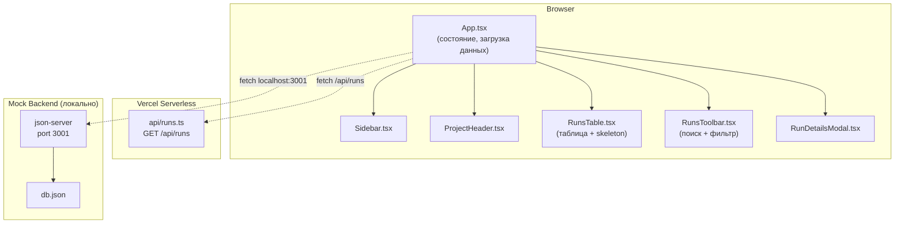

# RUNFORGE — AI Agent Dashboard

Дашборд для мониторинга и управления запусками AI-агентов (Claude Code, Codex и др.) в проекте. Аналог CI/CD-панели (GitHub Actions / GitLab CI), но для задач, выполняемых AI-кодинговыми агентами.

> **Стек:** React 19 + TypeScript + Vite 8
> **Технологии:** CSS Grid, Figma-верстка, json-server (mock API)

---

## 📋 Описание проекта

RUNFORGE — это веб-приложение, позволяющее разработчикам отслеживать статус запуска AI-агентов по всем репозиториям проекта. Интерфейс показывает список задач, их статус, привязку к репозиториям и веткам, а также позволяет детально просмотреть каждый запуск.

Проект создан в рамках задания на позицию Junior Frontend Developer.

---

## ✅ Реализованный функционал

### 1. Боковая навигация (Sidebar)

- Логотип и название **RUNFORGE**
- Навигационные пункты: **Runs**, **Projects**, **Devboxes**, **Previews**, **Snapshots**
- Кнопка **Settings** со счётчиком
- Профиль пользователя (аватар, имя, workspace)
- Адаптивное поведение на экранах ≤ 1080px (sidebar сворачивается в горизонтальную панель)

### 2. Заголовок проекта (ProjectHeader)

- Breadcrumb: `PROJECT / web-platform`
- Заголовок страницы: **Recent runs**
- Кнопка **New run**

### 3. Таблица запусков (RunsTable)

- Загрузка данных из mock API (`json-server`)
- **Skeleton-анимация** при загрузке (shimmer-эффект)
- Ошибочное состояние с текстом ошибки и кнопкой «Повторить»
- Пустое успешное состояние «NO DATA» с кнопкой «Reset filter and reload»
- Колонки: **Run**, **Repository**, **Status**, **Action**
- Цветные бейджи статусов:
  - 🟡 **Queued** — Ожидает запуска
  - 🟢 **Running** — Выполняется
  - 🔵 **Succeeded** — Успешно завершён
  - 🔴 **Failed** — Завершён с ошибкой
- Кнопка открытия деталей (↗) в каждой строке

### 4. Панель инструментов (RunsToolbar)

- **Поиск** по названию запуска или репозиторию
- **Фильтр по статусу** (select): All, Queued, Running, Succeeded, Failed, Dev mode
- Фильтр меняет цвет фона в зависимости от выбранного статуса
- Вкладка «Список запусков» (UI-заготовка)

### 5. Модальное окно деталей запуска (RunDetailsModal)

- Repository, Status, Task, Agent, Branch, Started
- Закрытие по клику на оверлей и по кнопке ×
- ARIA-атрибуты для доступности

### 6. Адаптивная вёрстка

- Десктоп: двухколоночная сетка (sidebar + main panel)
- Планшет (≤ 1080px): sidebar сворачивается, остаются только иконки навигации
- Мобильный (≤ 480px): компактный toolbar, скрытые элементы

### 7. Доступность (Accessibility)

- `aria-label` на интерактивных элементах
- `sr-only` класс для скрытых подписей
- `aria-busy` при загрузке данных
- `aria-modal` и `role="dialog"` для модального окна
- `prefers-reduced-motion` — отключение анимации скелетона

### 8. Mock API (локально) и Serverless API (продакшен)

- **Локально:** `json-server` на порту **3001**, данные из `db.json`, загрузка через `fetch("http://localhost:3001/runs")`
- **Продакшен:** Serverless-функция `api/runs.ts` на Vercel, данные захардкожены, загрузка через `fetch("/api/runs")`

---

## 🚧 Не реализовано (UI-разметка подготовлена)

| Функция                        | Статус UI         | Описание                                                                                          |
| ------------------------------ | ----------------- | ------------------------------------------------------------------------------------------------- |
| **Навигация по разделам**      | ✅ Готово         | Ссылки `href="#"` — Projects, Devboxes, Previews, Snapshots, Settings не ведут никуда             |
| **Создание нового запуска**    | ✅ Кнопка есть    | Кнопка «New run» не имеет обработчика — нет формы и логики создания                               |
| **Живые обновления**           | ✅ Индикатор есть | Метка «Live updates» с зелёной точкой — но polling/WebSocket не реализованы                       |
| **Детальная страница запуска** | ✅ Модалка есть   | Модальное окно показывает данные, но нет полноценной страницы с логами, diff-ами и т.д.           |
| **Пагинация**                  | ❌ Нет            | Таблица показывает все записи сразу                                                               |
| **Сортировка таблицы**         | ❌ Нет            | Нет возможности сортировать по колонкам                                                           |
| **Редактирование/удаление**    | ❌ Нет            | Нет действий над запусками                                                                        |
| **Тёмная тема**                | ⚠️ Частично       | `index.css` содержит переменные для dark mode, но основной интерфейс (`App.css`) не переключается |
| **Backend-интеграция**         | ❌ Нет            | Данные захардкожены в `db.json`, нет реального API                                                |

---

## 🚀 Инструкция по запуску

### Предварительные требования

- **Node.js** 18+ (рекомендуется 20+)
- **npm** 9+

### Установка зависимостей

```bash
cd AI-dashboard
npm install
```

### Запуск в режиме разработки

Проект требует **два терминала**:

#### Терминал 1 — Mock API (json-server)

```bash
npm run mock
```

Запускает локальный REST API на **http://localhost:3001** с данными из `db.json`.

#### Терминал 2 — Dev-сервер (Vite)

```bash
npm run dev
```

Запускает React-приложение на **http://localhost:5173**.

> **Важно:** Оба процесса должны работать одновременно. Если json-server не запущен или запрос завершится ошибкой, таблица покажет отдельное состояние ошибки с описанием проблемы и кнопкой «Повторить». Пустой ответ API или отсутствие совпадений поиска/фильтра показывают «NO DATA» с кнопкой «Reset filter and reload».

### Сборка для продакшена

```bash
npm run build
```

Результат — статические файлы в папке `dist/`.

### Предпросмотр продакшен-сборки

```bash
npm run preview
```

### Линтинг

```bash
npm run lint
```

### Тестирование

Проект использует **Vitest**, **React Testing Library** и **jest-dom** для проверки пользовательских сценариев компонента `App`.

Для запуска тестов в обычном режиме:

```bash
npm run test
```

Для однократного запуска всех тестов:

```bash
npm run test:run
```

Перед запуском тестов mock-сервер не обязателен: в `src/App.test.tsx` запрос `fetch` заменён mock-ответом с тестовыми данными.

#### Реализованные тесты

Файл `src/App.test.tsx` содержит три сценария:

1. **Фильтрация по статусу** — выбор статуса `Running` оставляет только запуски со статусом `RUNNING`.
2. **Поиск вместе с фильтром** — ввод репозитория `payment` и выбор статуса `Succeeded` оставляют только подходящий запуск.
3. **Открытие деталей запуска** — нажатие на кнопку с `aria-label="Open Auth refactor"` открывает модальное окно с агентом и веткой выбранного запуска.

Конфигурация тестового окружения находится в `vitest.config.ts`, а дополнительные matchers подключаются через `src/test/setup.ts`.

---

## 🌐 Деплой на Vercel

Приложение размещено на Vercel и доступно по адресу:

👉 **[ai-dashboard-two-theta.vercel.app](https://ai-dashboard-two-theta.vercel.app/)**

### Как устроен деплой

| Файл | Назначение |
|---|---|
| `api/runs.ts` | Serverless-функция, отдаёт данные запусков при запросе `GET /api/runs` |
| `vercel.json` | Роутинг: `/api/*` → serverless-функция, остальное → `index.html` |
| `src/App.tsx` | `fetch("/api/runs")` — относительный путь, работает и локально, и на продакшене |

### Процесс деплоя

1. Запушить изменения в GitHub-репозиторий
2. Vercel автоматически обнаруживает репозиторий и запускает билд
3. Serverless-функция `api/runs.ts` разворачивается как отдельный endpoint
4. Статические файлы `dist/` развёртываются как SPA

> **Важно:** Данные захардкожены в `api/runs.ts`, так как `import` JSON не поддерживается в Vercel serverless-функциях. Для продакшена с реальным API замените функцию на вызов внешнего REST API.

---

## 📁 Структура проекта

```
AI-dashboard/
├── src/
│   ├── components/
│   │   ├── Sidebar.tsx              # Боковая навигация
│   │   ├── ProjectHeader.tsx        # Заголовок проекта
│   │   ├── RunsTable.tsx            # Таблица запусков
│   │   ├── RunsToolbar.tsx          # Поиск и фильтр
│   │   └── RunDetailsModal.tsx      # Модальное окно деталей
│   ├── types/
│   │   └── run.ts                   # TypeScript-типы (Run, RunStatus)
│   ├── test/
│   │   └── setup.ts                 # Настройка jest-dom для Vitest
│   ├── App.test.tsx                 # Тесты фильтра, поиска и модального окна
│   ├── App.tsx                      # Корневой компонент
│   ├── App.css                      # Стили основного интерфейса
│   ├── main.tsx                     # Точка входа
│   └── index.css                    # Глобальные стили, CSS-переменные
├── api/
│   └── runs.ts                  # Serverless API (Vercel)
├── public/
│   └── favicon.svg
├── db.json                          # Mock-данные (json-server)
├── vercel.json                  # Роутинг Vercel
├── vite.config.ts               # Конфигурация Vite
├── vitest.config.ts                 # Конфигурация Vitest
├── tsconfig.app.json                # TypeScript (app)
├── tsconfig.node.json               # TypeScript (node)
├── eslint.config.js                 # ESLint правила
├── package.json
└── index.html
```

---

## 🏗 Архитектура



---

## 📦 Зависимости

### Production

| Пакет       | Версия  | Назначение    |
| ----------- | ------- | ------------- |
| `react`     | ^19.3.1 | UI-библиотека |
| `react-dom` | ^19.3.1 | Рендеринг DOM |

### Development

| Пакет                         | Версия   | Назначение                     |
| ----------------------------- | -------- | ------------------------------ |
| `vite`                        | ^8.4.0   | Сборщик / dev-сервер           |
| `typescript`                  | ~6.0.3   | Типизация                      |
| `@vitejs/plugin-react`        | ^6.3.0   | Babel-плагин для JSX           |
| `json-server`                 | ^0.17.4  | Mock REST API                  |
| `eslint`                      | ^10.15.0 | Линтинг                        |
| `typescript-eslint`           | ^8.73.0  | ESLint для TS                  |
| `vitest`                      | ^5.1.2   | Тестирование                   |
| `@testing-library/react`      | ^16.3.3  | Тестирование React-компонентов |
| `@testing-library/user-event` | ^14.6.13 | Имитация действий пользователя |
| `@testing-library/jest-dom`   | ^8.0.0   | Matchers DOM для тестов        |
| `jsdom`                       | ^29.1.1  | DOM-окружение для Vitest       |
